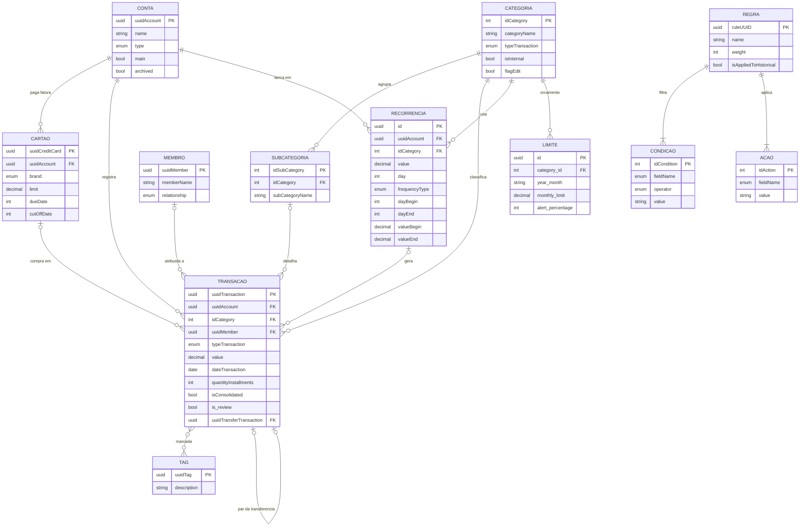
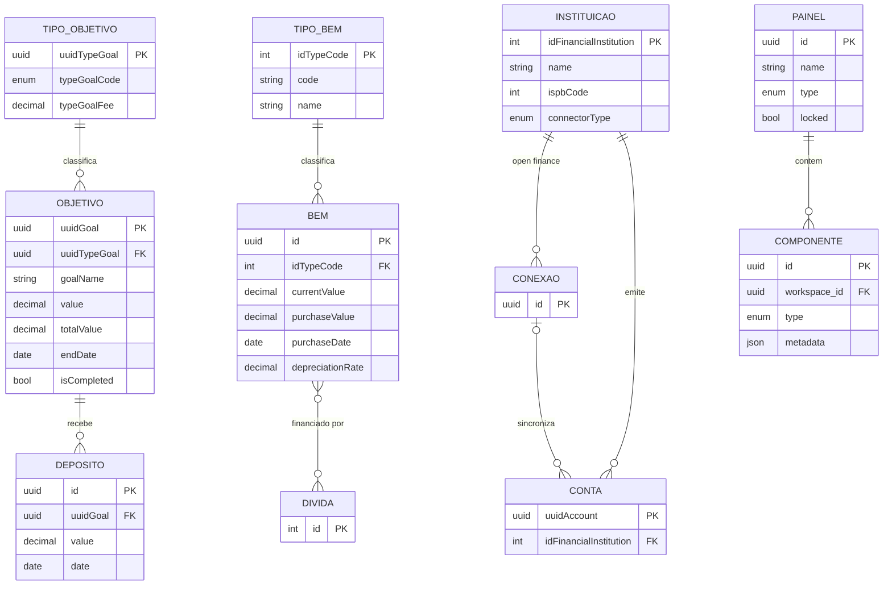

# Modelo de dados

> Última atualização: 2026-10-25

Entidades inferidas a partir das respostas da API. Campos listados como aparecem no JSON.

> Este é o modelo do **Minhas Economias**. O modelo do próprio finfy está em [../finfy/data-model.md](../finfy/data-model.md).

## Diagramas

As relações são **inferidas** pelos campos das respostas (por exemplo, `uuidAccount` dentro de uma transação); não há esquema oficial. Os diagramas mostram só os campos-chave; a lista completa de cada entidade está nas seções abaixo.

### Núcleo financeiro

Notas:

- Transação pertence a uma conta ou a um cartão (gasto no cartão ainda não testado).
- Tags são associadas pelo **nome** no `PATCH` (`{"tags": ["teste"]}`), não pelo `uuidTag`.
- Uma transferência são duas transações ligadas por `uuidTransferTransaction`.
- Ocorrências geradas por recorrência têm `isConsolidated: false`. O campo que liga a transação à recorrência não foi visto na resposta.
- Regras valem para todas as transações do usuário (`scope: INVESTOR`); não há chave estrangeira para conta ou categoria, só condições e ações.

### Planejamento, patrimônio e painéis

Notas:

- Dívidas (`credit-operations/options`) e conexões (`v2/connections`) vieram vazias na conta de teste; seus campos ainda não foram vistos.
- `DEPOSITO` é o lançamento criado por `goals/{uuid}/register` (`typeTransaction: GANHO`). **(inferido)** Pode ser uma transação comum ligada ao objetivo.
- O vínculo bem–dívida vem de `creditOperationIds` no bem e de `debtPosition` na resposta.
- Componentes guardam posição e tamanho em `metadata`, um JSON serializado em string.

## Conta

`uuidAccount`, `name`, `description`, `type`, `typeValue`, `idFinancialInstitution`, `financialInstitution` (`id`, `name`, `image_url`, `color`, `svg_white`), `image`, `color`, `main`, `archived`, `lastSyncedAt`, `connectionDeletion`, `dateInsert`, `dateUpdate`, `createdAt`, `updatedAt`.

`type`: `CARTEIRA`, `CONTA_CORRENTE`, `POUPANCA`, `INVESTIMENTO`, `BENEFITS`, `OUTROS`.

## Cartão de crédito

`uuidCreditCard`, `uuidAccount`, `name`, `brand`, `brandImage`, `limit`, `usedValue`, `annuity`, `dueDate`, `cutOffDate`, `main`, `dateConfirmation`, `color`, `idFinancialInstitution`.

`brand` (envio): `VISA`, `MASTERCARD`, `HIPERCARD`, `AMERICAN_EXPRESS`, `ELO`, `OUTRA`.

## Transação

`uuidTransaction`, `transactionId` (numérico), `description`, `originalDescription`, `value`, `totalValue`, `type`/`typeTransaction` (`GASTO`, `GANHO`), `date`/`dateTransaction`, `category`, `subCategory`, `account`, `uuidMember`, `tags`, `quantityInstallments`, `isConsolidated`, `projected`, `is_review`, `canMarkAsReviewed`, `isDisabled`, `isAdjustment`, `isInvoicePayment`, `invoice`, `isSuggestion`, `archived`, `isDeletable`, `isEditable`, `isCategoryEditable`, `uuidTransferTransaction`.

Status nos filtros: `CONFIRMED`, `PENDING` (e ignorada, nome de API não visto).

## Recorrência

`id`, `userId`, `recurrenceName`, `description`, `typeTransaction`, `value`, `day`, `dayBegin`, `dayEnd`, `valueBegin`, `valueEnd`, `frequencyType`, `frequencyWeekdays`, `frequencyAnnualMonths`, `uuidAccount`, `uuidCreditCard`, `idCategory`, `idSubCategory`, `validFrom`, `status` (`ACTIVE`), `recurrenceType` (`REGULAR`), `installmentFinished`.

`frequencyType`: `NUNCA`, `DIARIO`, `SEMANAL`, `QUINZENAL`, `MENSAL`, `BIMESTRAL`, `TRIMESTRAL`, `SEMESTRAL`, `ANUAL`.

## Regra

`ruleUUID`, `ruleId`, `name`, `scope` (`INVESTOR`), `status` (`ACTIVE` no envio, `AT` gravado), `origin` (`USER`), `weight`, `isAppliedToHistorical`, `createdAt`, `conditions[]` (`idCondition`, `fieldName`, `operator`, `value`), `actions[]` (`idAction`, `fieldName`, `value`).

Campos de condição vistos: `DESCRIPTION`, `TRANSACTION_TYPE`, `TRANSACTION_DATE`. Os de CPF/CNPJ, valor, dias, dias da semana, meses e conta existem na tela, mas o nome na API ainda não foi visto. Operadores: `SIMILARITY`, `EQUALS`, `GREATER_THAN_OR_EQUAL`. Ações: `CATEGORY` (descrição e membro existem na tela, nome na API não visto).

## Categoria e subcategoria

Categoria: `idCategory`, `categoryName`, `typeTransaction`, `color`, `urlIcon`, `isVisible`, `isInternal`, `flagEdit`, `transactionCount`, `transactionCountPeriodDays`, `priorityScore`, `subCategories[]`.

Subcategoria: `idSubCategory`, `idCategory`, `subCategoryName`, `edit`.

## Limite (orçamento)

`id`, `category_id`, `year_month`, `referenceMonth`, `monthly_limit`, `alert_percentage`, `created_at`, `createdAt`, `updatedAt`.

## Objetivo

`uuidGoal`, `goalName`, `value`, `totalValue`, `isCompleted`, `startDate`, `endDate`, `fee`, `typeGoal` (`uuidTypeGoal`, `typeGoalName`, `typeGoalFee`, `typeGoalCode`), `notificationInterval`, `sendNotification`, `sendPreviousNotification`, `emailNotification`, `pushNotification`, `valueSavedPerMonth[]` (`month`, `date`, `referenceMonth`, `value`).

`typeGoalCode`: `RETIREMENT`, `SAVINGS`, `CONTRIBUTION`, `WITHDRAWAL`, `DEBT`.

## Membro

`uuidMember`, `memberName`, `relationship`, `birthDate`, `image`, `totalSpending`, `createdAt`, `updatedAt`.

## Bem

`id`, `idTypeCode`, `typeName`, `description`, `currentValue`, `purchaseValue`, `purchaseDate`, `depreciationRate`, `icon`, `color`, `debtPosition` (`debts`, `originalDebtTotal`, `outstandingDebtTotal`, `netValue`, `ownershipPercentage`).

## Patrimônio

`netWorth`, `totalAssets`, `totalDebts`, `assets`/`debts` (`total`, `sections[]` com `type`/`sectionType`, `label`, `total`, `percentage`, `items[]`), `investmentIsStale`, `compositionDate`.

## Instituição de Open Finance

`type`, `uuidFinancialInstitution`, `financialInstitutionName`, `financialInstitutionType` (`PERSONAL_BANK`, `BOTH_BANK`, `LEGAL_BANK`), `typeConnection` (`OPEN_FINANCE`), `connectorType` (`LINA`), `credentials[]` (`name`, `label`, `validation`, `isHidden`, `isToken`, `placeholder`), `isActive`, `isBeta`, `ordination`, `cdBenefit`.

## Painel e componente

Painel: `id`, `name`, `type` (`ANY_WHERE`), `components[]`, `active`, `visible`, `locked`, `smart_tilling`, `lastColorLink`, `indexShow`, `dataDeCriacao`, `dataDeAtualizacao`, `workspaceTemplateId`.

Componente: `id`, `name`, `type` (ex.: `ME_OBJECTIVE_LIST`), `metadata` (JSON em string com `headerOptions` e `layout`).

Widget do Padrão: `code`, `nameBr`, `nameUs`, `descriptionBr`, `descriptionUs`, `idWidget`, `active`, `orderWidget`.
