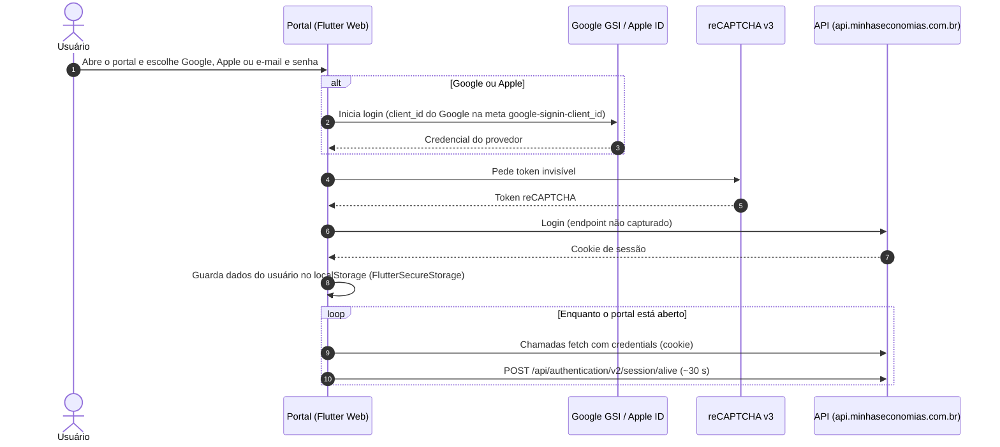

# Arquitetura

> Última atualização: 2026-10-25

O portal é um app **Flutter Web** de página única que conversa com uma API REST/JSON em `api.minhaseconomias.com.br`. A sessão vai num cookie; nenhuma requisição leva cabeçalho `Authorization`.

## Componentes

| Camada | O que foi encontrado |
| --- | --- |
| Frontend | Flutter Web renderizado em canvas, sem DOM acessível. Bootstrap em `flutter_bootstrap.<hash>.js`. `meta generator=Flutter`. |
| Chamadas HTTP | `fetch` do navegador (não XHR). Corpos enviados como bytes UTF-8 (Uint8Array). |
| API | `https://api.minhaseconomias.com.br`, REST com JSON. |
| Serviços da API | `/financial-core/v1` e `/v2` (núcleo financeiro), `/api/authentication/v2` (sessão), `/api/workspaces` (painéis), `/api/trademap` (CRM, banners, analytics), `/v1/transaction` (tipos de recorrência), `/v1/support` (FAQ). |
| Imagens | `cdn-dev.valebroker.com.br/dev/...` (logos de bancos por código, ícones de categoria, bandeiras de cartão). |
| Feature flags | `POST /financial-core/v1/feature-name` devolve `{features: {NOME: valor}}`, por exemplo `IS_EXPORT_SHEET_ENABLED`, `LABS_WIDGET_ENABLED`. |
| Observabilidade | Sentry (browser tracing 10.38), Cloudflare Web Analytics, eventos próprios em `POST /api/trademap/v1/analytics/save-events`. |

## Autenticação

- Login por Google (Google Identity Services, `accounts.google.com/gsi/client`), Apple (`appleid.auth.js`) ou e-mail e senha.
- reCAPTCHA v3 protege o login.
- A sessão é um cookie do domínio da API. Confirmado: um `fetch(..., {credentials: 'include'})` feito da página, sem token, foi aceito.
- `POST /api/authentication/v2/session/alive` é chamado a cada ~30 segundos para manter a sessão.

### Fluxo

A chamada de login em si ainda não foi capturada (a conta já estava logada quando a rede começou a ser monitorada); por isso ela aparece como "não capturado". Ver [pendencias.md](pendencias.md).

Com login salvo, o portal reabre direto na última rota (`keyCurrentRoute`) e pede o token do reCAPTCHA logo após a primeira tela; o script da página carrega o reCAPTCHA cedo por isso.

## Estado local do navegador

O app guarda dados em `localStorage` com o prefixo `FlutterSecureStorage.`:

| Chave | Uso (inferido pelo nome) |
| --- | --- |
| `_keyUserSecureData`, `_userHomeLoginKey` | dados do usuário logado |
| `keyCurrentRoute` | última rota aberta (o app reabre nela) |
| `flutter.keyThemeTypeIndex` | tema claro/escuro |
| `showOnboarding`, `has_seen_my_expenses_onboarding_v2` | tutoriais já vistos |
| `_isBiometricEnabledKey`, `keyIsHapticFeedback` | preferências herdadas do app móvel |
| `keyIdInvestor` | ID do investidor (a API usa `scope: INVESTOR` nas regras) |
| `vm_local_db_local_data_events` | fila local de eventos |

## Convenções da API

- Datas em `AAAA-MM-DD` na query string; data e hora em ISO no corpo.
- O servidor grava transações sempre às 12:00, qualquer que seja a hora enviada.
- IDs de conta, transação, regra, objetivo e painel são UUIDs. Categorias usam IDs numéricos.
- A maioria dos campos é camelCase, mas há exceções em snake_case (`is_review`, `budget/category`, `workspace_id`, `year_month`). Ver [problemas-encontrados.md](problemas-encontrados.md).
- Algumas respostas falham com 503 no primeiro carregamento e o app repete sozinho.

## Retorno do Open Finance

A URL do portal com `?action=CONEXAO_CONCLUIDA` é a página de retorno do banco: um script inline fecha essa aba antes de carregar o app.
