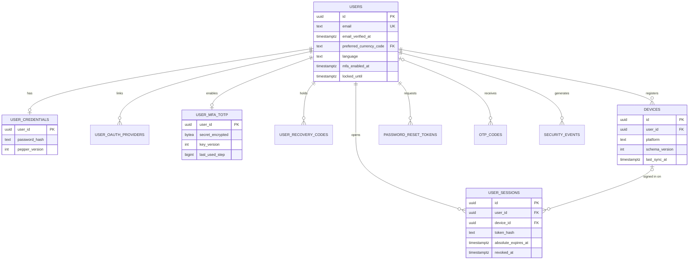
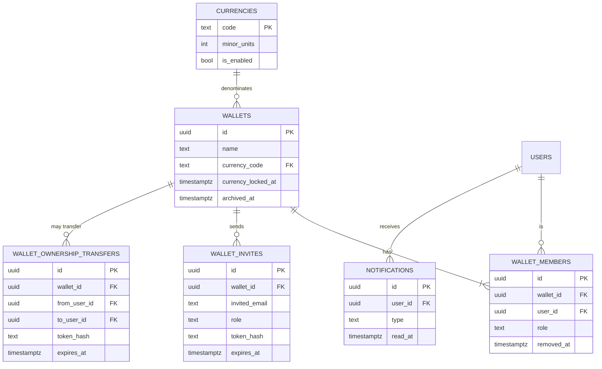
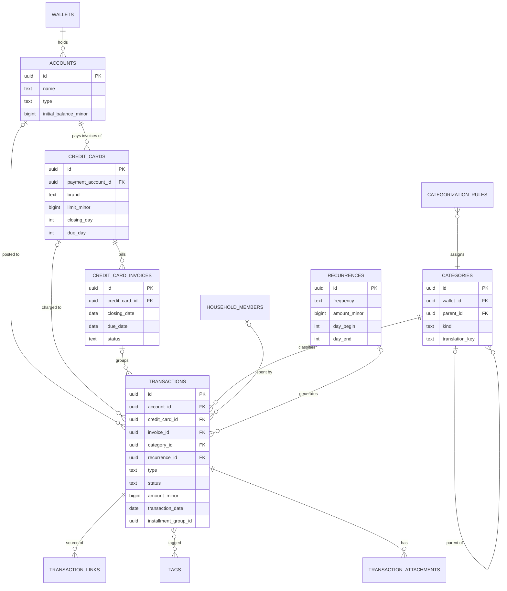
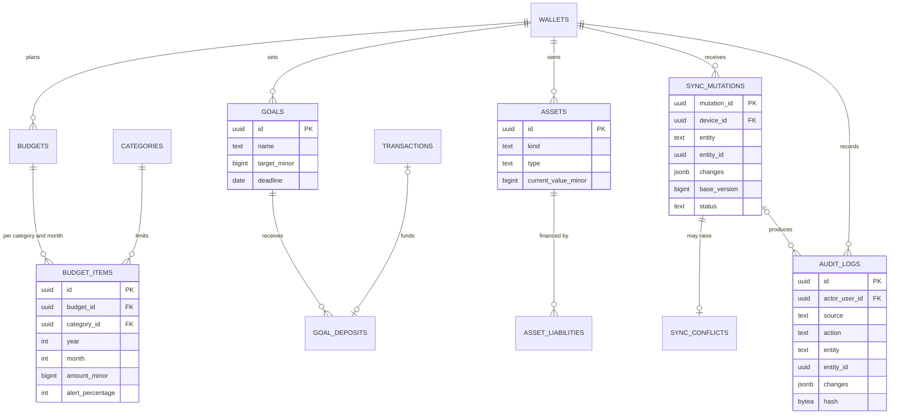

# finfy — Data model

> Last updated: 2026-10-25

This is the data model of **finfy** itself. It consolidates the decisions in [`../decisoes/`](../decisoes/README.md) and proposes the financial core. For the reverse-engineered model of the Minhas Economias app, see [`../api/modelo-de-dados.md`](../api/modelo-de-dados.md) instead.

| Area | Status | Source |
| --- | --- | --- |
| Identity and security | Proposed | [0004](../decisoes/0004-seguranca-da-conta.md) |
| Wallets, sharing, invites | Proposed | [0001](../decisoes/0001-multimoeda.md), [0002](../decisoes/0002-wallets-e-compartilhamento.md), [0003](../decisoes/0003-convites-por-email.md) |
| Sync and audit | Proposed (sync technology decided) | [0005](../decisoes/0005-offline-first-e-sincronizacao.md), [0006](../decisoes/0006-auditoria.md) |
| Financial core, planning, patrimony | **Draft, no decision yet** | Adapted from Wallefy (`my-fin/docs/data-model.md`), see [`../referencias/wallefy.md`](../referencias/wallefy.md) |

## Conventions

- **Database:** PostgreSQL on the server (source of truth), schema and migrations with **Drizzle** ([0010](../decisoes/0010-nextjs-na-vercel.md)). Native apps keep a SQLite replica through PowerSync; the web keeps nothing locally ([0005](../decisoes/0005-offline-first-e-sincronizacao.md), [0009](../decisoes/0009-react-tauri-capacitor.md)).
- **IDs:** UUIDv7 (`uuid`), generated on the client for synced tables. Recurrence occurrences use UUIDv5 of `recurrence_id` + date so two offline devices create the same ID.
- **Money:** `bigint` in minor units (`*_minor` columns). The currency is always the wallet's (`wallets.currency_code`); entities inside a wallet do not carry their own currency. Decimal places come from `currencies.minor_units`.
- **Enums:** `text` with a `CHECK` constraint, not native Postgres enums, so values can be added without migrations that lock tables.
- **Timestamps:** `timestamptz` in UTC. Calendar dates (transaction date, due date) are `date`.
- **Soft delete:** synced tables are never hard-deleted by the app; they get `archived_at`. Hard deletes only happen server-side for account or wallet erasure (LGPD/GDPR).
- **Tenancy:** every financial row has `wallet_id`. Every ID referenced in a write must belong to the same wallet (system categories excepted). Permissions are checked against `wallet_members` on every request.

### Common columns of synced tables

Every table marked **synced** below has these columns in addition to its own:

| Column | Type | Notes |
| --- | --- | --- |
| `id` | uuid PK | UUIDv7 |
| `wallet_id` | uuid FK → `wallets` | Tenancy and sync partition |
| `version` | bigint | Incremented by the server on every accepted change |
| `created_at`, `created_by` | timestamptz, uuid FK → `users` | |
| `updated_at`, `updated_by` | timestamptz, uuid FK → `users` | Set by the server, not the device clock |
| `archived_at`, `archived_by` | timestamptz, uuid FK → `users` | Soft delete |

They are omitted from the diagrams and tables below to keep them readable.

### Sync-ready schema rules

The web ships first and does not sync, but the schema must already work with PowerSync, so the native apps can be added without reshaping tables ([0005](../decisoes/0005-offline-first-e-sincronizacao.md), [0010](../decisoes/0010-nextjs-na-vercel.md)). The server schema is written with **Drizzle**.

**Table shape**

1. Every synced table has a single-column primary key named `id` (uuid). No composite primary keys: link tables get their own `id` plus a unique constraint on the pair.
2. Link rows that two offline devices could create independently use a **deterministic UUIDv5** (e.g. `transaction_tags.id` from `transaction_id` + `tag_id`), the same trick as recurrence occurrences.
3. Every synced row carries `wallet_id` directly, so sync streams can filter by wallet without deep joins. Exceptions: `wallets` (filtered by its own `id`) and system rows with `wallet_id` NULL (system categories), which go to every user.
4. Use only types with a clean SQLite mapping on the client. PowerSync maps them as follows:

| Postgres | Client SQLite | Rule |
| --- | --- | --- |
| `uuid`, `text`, `date`, `jsonb` | `text` | jsonb arrives as a JSON string; parse it in the data layer |
| `bigint`, `integer` | `integer` | All money (`*_minor`) |
| `boolean` | `integer` (0/1) | |
| `timestamptz` | `text` (ISO 8601, UTC) | Never `timestamp` without time zone |
| `numeric` | `text` | Avoid on synced tables; money is never `numeric` |
| `bytea` | does not sync | Not allowed on synced tables; files go to object storage |
| native enums, arrays, ranges | `text` | Not used: enums are `text` + `CHECK`; lists are jsonb or a link table |

**What the client cannot enforce**

5. The local SQLite has no foreign keys, unique constraints or cascades. Rows can arrive in any order. The client must tolerate a missing parent (e.g. a transaction whose category has not synced yet).
6. Uniqueness is decided by the server when the mutation arrives. Example: two devices create the tag "food" offline; the server keeps one and repoints the other's links, recording it in the audit log.

**One write path**

7. Every write goes through one set of server commands, whether it comes from a web request or from `POST /api/sync/push`. Each command checks permission, validates, merges by field, bumps `version` and writes the audit log ([0006](../decisoes/0006-auditoria.md)).
8. The web follows the same rules as the native apps:
   - it generates the UUIDv7 IDs on the client;
   - it sends a `mutation_id` for idempotency;
   - it sends the `version` it was editing as `base_version`.

   A web edit can then produce the same conflicts as an offline one.

**Migrations**

9. **Expand, then contract.** Add columns or tables first. Stop using the old ones in a later release. Drop them only once no supported app version reads them. Never rename or drop a synced column in a single release.
10. A schema change and the matching PowerSync sync config (and client schema) ship together. The client sends its `schema_version`; the server rejects versions that are too old ([0005](../decisoes/0005-offline-first-e-sincronizacao.md#versões-do-app)).
11. The client-side PowerSync schema is generated from (or checked in CI against) the Drizzle schema in `packages/shared`, so the two cannot drift.

**Replication and security**

12. The Postgres publication `powersync` lists only synced tables. Never use `FOR ALL TABLES`: credentials, sessions, MFA secrets, invites' token hashes, the email outbox and the audit log must not flow through the sync service.
13. The replication role (`REPLICATION`, `BYPASSRLS`, `LOGIN`, `SELECT` only on published tables) is separate from the API role.
14. Columns that a member should not see (e.g. another user's email) are not selected by the sync streams, even if the table is synced.

## Diagrams

### Identity and security



### Wallets and sharing



### Financial core (draft)



### Planning, patrimony, sync and audit (draft for planning and patrimony)



## Tables

### Identity and security ([0004](../decisoes/0004-seguranca-da-conta.md))

| Table | Columns | Notes |
| --- | --- | --- |
| `users` | `id`, `name`, `email` (unique, lowercased), `email_verified_at`, `language` (`pt-BR`, `en`; `pt-PT` later, see [0011](../decisoes/0011-traducoes.md)), `preferred_currency_code` → `currencies`, `mfa_enabled_at`, `failed_login_count`, `locked_until`, `created_at`, `updated_at`, `deleted_at` | `deleted_at` + pseudonymization on account erasure |
| `user_credentials` | `user_id` PK, `password_hash`, `pepper_version`, `password_changed_at` | Argon2id in PHC format (salt embedded); HMAC-SHA256 pepper applied before hashing |
| `user_oauth_providers` | `id`, `user_id`, `provider` (`GOOGLE`, `APPLE`), `provider_user_id`, `email`, `created_at` | Unique (`provider`, `provider_user_id`); provider tokens not stored |
| `user_mfa_totp` | `user_id` PK, `secret_encrypted`, `key_version`, `confirmed_at`, `last_used_step` | AES-256-GCM, key outside the database |
| `user_recovery_codes` | `id`, `user_id`, `code_hash`, `used_at` | 10 codes per generation |
| `otp_codes` | `id`, `user_id` (nullable), `email`, `purpose` (`EMAIL_VERIFY`, `LOGIN`, `STEP_UP`, `MFA_FALLBACK`), `code_hash`, `expires_at`, `attempts`, `used_at` | 10 min, 5 attempts |
| `user_sessions` | `id`, `user_id`, `device_id`, `token_hash`, `ip`, `user_agent`, `last_seen_at`, `idle_expires_at`, `absolute_expires_at`, `step_up_until`, `revoked_at`, `created_at` | Opaque token; only SHA-256 stored |
| `password_reset_tokens` | `id`, `user_id`, `token_hash`, `expires_at`, `used_at` | 30 min |
| `security_events` | `id`, `user_id`, `type`, `ip`, `user_agent`, `metadata` (jsonb), `created_at` | Account-level events, separate from `audit_logs` |
| `devices` | `id`, `user_id`, `name`, `platform` (`WINDOWS`, `MACOS`, `ANDROID`, `IOS`, `WEB`), `schema_version`, `last_sync_at`, `revoked_at` | Web sessions also get a device row, without sync |

### Wallets and sharing ([0001](../decisoes/0001-multimoeda.md), [0002](../decisoes/0002-wallets-e-compartilhamento.md), [0003](../decisoes/0003-convites-por-email.md))

| Table | Columns | Notes |
| --- | --- | --- |
| `currencies` | `code` PK (ISO 4217), `name`, `symbol`, `minor_units`, `is_enabled` | Seed: `EUR`, `BRL` |
| `wallets` | `id`, `name`, `currency_code` → `currencies`, `currency_locked_at`, `created_by`, `version`, `created_at`, `updated_at`, `archived_at` | No `owner_id`: ownership lives in `wallet_members` |
| `wallet_members` | `id`, `wallet_id`, `user_id`, `role` (`OWNER`, `ADMIN`, `EDITOR`, `VIEWER`), `invited_by`, `joined_at`, `removed_at`, `removed_by`, `created_at`, `updated_at` | Unique active (`wallet_id`, `user_id`); partial unique index: one active `OWNER` per wallet |
| `wallet_invites` | `id`, `wallet_id`, `invited_email`, `role`, `invited_by`, `token_hash`, `expires_at`, `accepted_at`, `accepted_by`, `declined_at`, `revoked_at`, `revoked_by`, `last_sent_at`, `send_count`, `created_at` | One pending invite per (`wallet_id`, `invited_email`) |
| `wallet_ownership_transfers` | `id`, `wallet_id`, `from_user_id`, `to_user_id`, `previous_owner_action` (`STAY_ADMIN`, `LEAVE`), `token_hash`, `expires_at`, `accepted_at`, `declined_at`, `canceled_at`, `created_at` | One pending transfer per wallet |
| `email_outbox` | `id`, `to_email`, `template`, `locale`, `payload` (jsonb), `status`, `attempts`, `sent_at`, `error`, `created_at` | Invites, transfers, security alerts |
| `notifications` | `id`, `user_id`, `wallet_id` (nullable), `type`, `title`, `body`, `payload` (jsonb), `read_at`, `created_at` | In-app notifications (invoice due, budget exceeded, invite, transfer...) |

### Financial core (draft) — all **synced**

| Table | Columns | Notes |
| --- | --- | --- |
| `accounts` | `name`, `type` (`CHECKING`, `SAVINGS`, `CASH`, `INVESTMENT`, `BENEFITS`, `OTHER`), `initial_balance_minor`, `institution_code` (nullable), `color`, `icon`, `is_default` | Balance is derived, not stored |
| `credit_cards` | `name`, `payment_account_id` → `accounts`, `brand` (`VISA`, `MASTERCARD`, `ELO`, `AMEX`, `HIPERCARD`, `OTHER`), `limit_minor`, `closing_day`, `due_day`, `color` | |
| `credit_card_invoices` | `credit_card_id`, `reference_year`, `reference_month`, `opening_date`, `closing_date`, `due_date`, `status` (`OPEN`, `PAID`; `CLOSED`/`OVERDUE` derived), `paid_at`, `payment_transaction_id` | Unique (`credit_card_id`, `reference_year`, `reference_month`) |
| `categories` | `wallet_id` (NULL = system), `parent_id` (max 2 levels), `name`, `translation_key`, `kind` (`INCOME`, `EXPENSE`, `BOTH`), `is_system`, `icon`, `color`, `is_hidden` | System categories are read-only; users can hide them |
| `transactions` | `account_id`, `credit_card_id`, `invoice_id`, `category_id`, `household_member_id`, `recurrence_id`, `occurrence_date`, `installment_group_id`, `installment_number`, `installment_total`, `type`, `status`, `description`, `amount_minor`, `transaction_date`, `due_date`, `paid_at`, `notes`, `needs_review` | See types and rules below |
| `transaction_links` | `source_transaction_id`, `target_transaction_id`, `type` (`TRANSFER`, `INVOICE_PAYMENT`, `REFUND`) | Both legs of a transfer; a refund to its purchase |
| `tags` | `name`, `color` | Unique (`wallet_id`, lower(`name`)) |
| `transaction_tags` | `transaction_id`, `tag_id` | `id` is UUIDv5 of (`transaction_id`, `tag_id`); unique (`transaction_id`, `tag_id`); tags are referenced by ID, never by name |
| `transaction_attachments` | `transaction_id`, `storage_key`, `file_name`, `mime_type`, `size_bytes`, `sha256` | File in object storage; upload requires internet |
| `recurrences` | `type` (`INCOME`, `EXPENSE`), `description`, `amount_minor`, `account_id` or `credit_card_id`, `category_id`, `frequency` (`DAILY`, `WEEKLY`, `BIWEEKLY`, `MONTHLY`, `BIMONTHLY`, `QUARTERLY`, `SEMIANNUAL`, `YEARLY`), `weekdays`, `months`, `day_of_month`, `start_date`, `end_date`, `match_day_tolerance`, `match_amount_tolerance_bps` | Tolerances recomputed whenever `amount_minor` changes (fixes the Minhas Economias bug) |
| `household_members` | `name`, `relationship` (`SELF`, `PARTNER`, `CHILD`, `PARENT`, `SIBLING`, `PET`, `OTHER`), `birth_date`, `color` | "Who spent it" labels; not app users |
| `categorization_rules` | `name`, `priority`, `is_active`, `apply_to_history`, `conditions` (jsonb), `actions` (jsonb) | Conditions: description contains/equals/starts with, amount range, account, type. Actions: category, household member, tag. Never applied to transfers or system categories |

**Transaction `type`:** `INCOME`, `EXPENSE`, `TRANSFER_IN`, `TRANSFER_OUT`, `CREDIT_CARD_PURCHASE`, `CREDIT_CARD_PAYMENT`, `ADJUSTMENT`, `REFUND`.

**Transaction `status`:** `PENDING` (scheduled, recurrence occurrence, card purchase on an unpaid invoice), `PAID`, `CANCELED`.

Rules (draft):

- `amount_minor` is always positive; `type` sets the direction. Exception: `ADJUSTMENT` is signed.
- Account balance = `initial_balance_minor` + Σ(`INCOME`, `TRANSFER_IN`, `REFUND` to account, `ADJUSTMENT`) − Σ(`EXPENSE`, `TRANSFER_OUT`, `CREDIT_CARD_PAYMENT`), over `PAID`, non-archived rows.
- Reports and the balance use the **same** status filter, so totals never disagree (unlike Minhas Economias, where spending and balance diverged).
- A transfer is two rows linked by `transaction_links`; archiving one leg archives both. Transfers are only between accounts of the same wallet (cross-currency transfers are out of scope for v1).
- Installments share `installment_group_id`; the total is split in minor units with leftover cents on the first installment; card installments go to the invoice of their own date.
- A recurrence occurrence has `recurrence_id` + `occurrence_date`, and its `id` is UUIDv5 of both. Creating a recurrence from an existing transaction links that transaction instead of creating a duplicate.
- Tags chosen in the create form are saved in the same write (fixes the Minhas Economias bug where tags were dropped).

### Planning and patrimony (draft) — all **synced**

| Table | Columns | Notes |
| --- | --- | --- |
| `budgets` | `name` | Named budgets, as in Wallefy |
| `budget_items` | `budget_id`, `category_id`, `year`, `month`, `amount_minor`, `alert_percentage` | Unique (`budget_id`, `category_id`, `year`, `month`); alert drives a notification |
| `goals` | `name`, `template` (`EMERGENCY_FUND`, `RETIREMENT`, `TRAVEL`, `HOUSE`, `CAR`, `EDUCATION`, `DEBT_PAYOFF`, `OTHER`), `target_minor`, `initial_minor`, `deadline`, `expected_annual_return_bps` (nullable), `achieved_at` | Saved amount is derived from deposits; if a return rate is set, it is actually used (fixes the ignored 7.45% rate in Minhas Economias) |
| `goal_deposits` | `goal_id`, `amount_minor`, `deposit_date`, `notes`, `transaction_id` (nullable) | Optionally linked to the transaction that funded it |
| `assets` | `kind` (`ASSET`, `LIABILITY`), `type` (`REAL_ESTATE`, `VEHICLE`, `ELECTRONICS`, `BUSINESS`, `COLLECTIBLE`, `RIGHTS`, `INVESTMENT`, `LOAN`, `FINANCING`, `OTHER`), `name`, `current_value_minor`, `purchase_value_minor`, `purchase_date`, `ownership_bps`, `notes` | Net worth = account balances + assets − liabilities − unpaid card purchases |
| `asset_liabilities` | `asset_id`, `liability_id` | Links an asset to the loan that financed it |

### Sync and audit ([0005](../decisoes/0005-offline-first-e-sincronizacao.md), [0006](../decisoes/0006-auditoria.md))

| Table | Columns | Notes |
| --- | --- | --- |
| `sync_mutations` | `mutation_id` PK, `wallet_id`, `user_id`, `device_id`, `entity`, `entity_id`, `op` (`CREATE`, `UPDATE`, `ARCHIVE`, `RESTORE`), `changes` (jsonb), `base_version`, `occurred_at`, `received_at`, `status` (`ACCEPTED`, `CONFLICT`, `REJECTED`), `reason` | Idempotency by `mutation_id` |
| `sync_conflicts` | `id`, `wallet_id`, `mutation_id`, `entity`, `entity_id`, `field`, `server_value`, `device_value`, `resolved_at`, `resolved_by`, `resolution` | Shown in the "Review conflicts" screen |
| `audit_logs` | `id`, `wallet_id`, `actor_user_id`, `device_id`, `source` (`APP`, `SYNC`, `RULE`, `RECURRENCE`, `IMPORT`, `SYSTEM`), `source_ref_id`, `action`, `entity`, `entity_id`, `changes` (jsonb), `occurred_at`, `recorded_at`, `mutation_id`, `correlation_id`, `prev_hash`, `hash` | Append-only; `UPDATE`/`DELETE` blocked |

PowerSync handles the download stream, so no server-side `pull` sequence table is needed. Sync rules select rows by the user's active `wallet_members`.

## Critical indexes

```
transactions        (wallet_id, transaction_date)
transactions        (wallet_id, category_id)
transactions        (wallet_id, account_id)
transactions        (invoice_id)
transactions        (recurrence_id, occurrence_date) unique where recurrence_id is not null
wallet_members      (user_id) where removed_at is null
wallet_members      (wallet_id) unique where role = 'OWNER' and removed_at is null
wallet_invites      (wallet_id, lower(invited_email)) unique where pending
audit_logs          (wallet_id, recorded_at)
audit_logs          (entity, entity_id)
sync_mutations      (wallet_id, received_at)
user_sessions       (token_hash) unique
notifications       (user_id, read_at)
```

## Changes from Wallefy

| Wallefy | finfy |
| --- | --- |
| SQLite + Turso, device is the source of truth | Postgres + PowerSync, server is the source of truth |
| `wallets.owner_id` and `OWNER` role both store ownership | Only `wallet_members` |
| Roles `OWNER`, `EDITOR`, `VIEWER` | Adds `ADMIN` |
| `accounts.currency` may differ from the wallet | One currency per wallet |
| Money ×100 always | `minor_units` per currency |
| `wallet_invites` without revoke/decline | Full invite lifecycle |
| No ownership transfer | `wallet_ownership_transfers` |
| `audit_logs` with full before/after, `CREATE`/`UPDATE` only | Field-level diff, source, membership events, hash chain |
| Denormalized names (`category_name`...) in `transactions` | Not stored: the local SQLite replica makes joins cheap; avoids keeping copies in sync |
| Categorization rule: single `match_type` + `pattern` | Conditions and actions as JSON, with priority |

## Open questions

- [ ] Is the financial core (transactions, cards, invoices, categories) approved as drafted, or should it get its own decision first?
- [ ] Should we keep Wallefy's denormalized names in `transactions` for reporting, or rely on joins as proposed?
- [ ] Refunds: separate `REFUND` type (proposed) or an `INCOME` linked by `transaction_links`?
- [ ] Do we need `fx_rates` in v1? (Answer pending in [0001](../decisoes/0001-multimoeda.md).)
